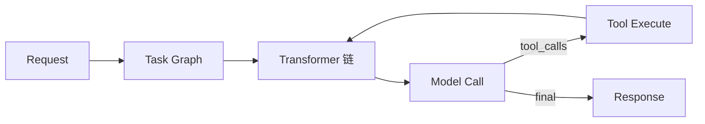

<div align="center">


# aipack

**轻量、可扩展、零魔法的 TypeScript Agent 框架**

Agent 运行时 + 可插拔插件生态，快速构建你自己的 AI Agent
零外部 Agent 框架依赖 · TypeScript 全类型覆盖 · 13 家模型提供商开箱即用

[](LICENSE)
[](package.json)
[](tsconfig.json)
[](pnpm-workspace.yaml)
[](https://github.com/luoguoxiong/aipack/pulls)

[核心特性](#-核心特性) · [架构总览](#-架构总览) · [快速开始](#-快速开始) · [核心包](#-核心包) · [示例应用](#-示例应用) · [开发指南](#-开发指南)

</div>

---

## 📖 目录

- [✨ 核心特性](#-核心特性)
- [🏗️ 架构总览](#-架构总览)
- [🚀 快速开始](#-快速开始)
- [💡 示例应用](#-示例应用)
- [🛠️ 开发指南](#-开发指南)
- [📋 Scripts 参考](#-scripts-参考)
- [🔐 API Key 配置](#-api-key-配置)
- [🤝 相关资源](#-相关资源)
- [📄 License](#-license)

---

## ✨ 核心特性

### 框架内核

- **轻量 Agent 框架** — 核心调度、会话持久化、工具执行、上下文转换全部自研，不依赖任何外部 Agent 框架
- **Runtime + Extension + Transformer 三段式架构** — 插件通过 Tapable 钩子挂载生命周期，扩展点清晰可控
- **流式与同步双入口** — `runtime.run()` 一次性返回结果，`runtime.stream()` 流式返回增量事件
- **持久化会话管理** — 内存 / 文件双存储适配器，支持 `maxAge` 过期惰性清理
- **框架级权限审批** — `PermissionPolicy` 四档裁决（allow / deny / confirm / pending）+ `ApprovalManager` 审批单 + `FileApprovalStore` 持久化，裁决先于工具执行，工具自身无法绕过

### 模型与上下文

- **多模型提供商支持** — OpenAI、DeepSeek、Anthropic、Google、Groq、Mistral、xAI、Moonshot 等 13+ 提供商开箱即用
- **跨会话长期记忆** — BM25 + 向量双路混合检索，自动捕获 / 注入 / 合并
- **上下文压缩** — 双水位预算触发（trigger / target）+ trim / summarize / truncate 策略管道（无损裁剪 / 有损摘要 / 截断），会话检查点与交接由 lifecycle 扩展支持

### 生态与交付

- **MCP 双向打通** — 既把外部 MCP Server 工具包装为原生 `Tool`，也把 aipack 工具反向暴露为标准 MCP Server
- **Agent Skills 插件** — 对齐 `SKILL.md` 开放规范，渐进式披露，零开销向后兼容
- **多 Agent 编排** — `AgentGraph` / Pipeline / Router / Supervisor / Debate / MapReduce 等编排模式
- **内置 Eval 评测体系** — `EvalCase` 用例格式 + 规则评分器 + mock fixture 回放（免 API Key）+ baseline 回归门禁，`aipack-eval` CLI 直接跑
- **可观测性全链路** — 埋点 SDK + 收集服务 + Web Dashboard，MySQL / ClickHouse 双库落盘，Prometheus `/metrics/prometheus` 导出
- **多端交付** — CLI 终端助手 + 可观测性 Web Dashboard + 文档网站，框架本身以库形式嵌入任意宿主应用

---

## 🏗️ 架构总览

```
┌──────────────────────────────────────────────────────────────┐
│                           应用层                              │
│   CLI  ·  Web Dashboard  ·  文档网站  ·  自定义集成(库接入)    │
└──────────────────────────────────────────────────────────────┘
                              │
┌──────────────────────────────────────────────────────────────┐
│                     插件生态 (Extensions)                     │
│  memory  ·  compression  ·  skills  ·  mcp  ·  observability │
│  multi-agent  ·  eval                                        │
└──────────────────────────────────────────────────────────────┘
                              │
┌──────────────────────────────────────────────────────────────┐
│                 @aipack-ai/agent  框架内核                    │
│                                                              │
│   Runtime      请求 → 任务图 → 上下文转换 → 模型调用 → 工具执行 │
│   Extension    Tapable 生命周期钩子 (beforeRun / done / failed)│
│   Transformer  数组顺序链式上下文转换 (工具配对 / 截断 / 快照)  │
│   Session      文件 / 内存双适配器持久化                       │
│   Permission   四档裁决 (allow / deny / confirm / pending)     │
│   AI 模型层    多提供商标准化目录 + 流式实现 (aipack/ai)        │
└──────────────────────────────────────────────────────────────┘
```

一次 `runtime.run()` / `runtime.stream()` 的核心链路：



---

## 🚀 快速开始

### 环境要求

| 依赖    | 版本                              |
| ------- | --------------------------------- |
| Node.js | `>= 18.0.0`（建议 18.19+）        |
| pnpm    | `>= 8`（推荐），亦可用 npm / yarn |

### 方式一：作为 CLI 使用

```bash
# 全局安装
npm install -g @aipack-ai/cli
# 或
pnpm add -g @aipack-ai/cli
```

```bash
# 1. 交互模式（REPL，/help 查看斜杠命令）
aipack

# 2. 非交互单次提问（支持管道 stdin）
aipack -p "用一句话介绍 aipack"
cat src/index.ts | aipack -p "这段代码有什么问题？"
```

### 方式二：作为库使用

```bash
pnpm add @aipack-ai/agent
```

```typescript
import {
  createRuntime,
  createRequest,
  getBuiltinModel,
  adaptAiModel,
  createStreamFnFromAi,
  createFileSessionStorage,
} from '@aipack-ai/agent';

// 1. 从内置模型目录获取 DeepSeek 模型
const aiModel = getBuiltinModel('deepseek', 'deepseek-chat');

// 2. 创建 Runtime（零手写 streamFn）
const runtime = await createRuntime({
  model: adaptAiModel(aiModel),
  streamFn: createStreamFnFromAi(aiModel),
  systemPrompt: '你是一个简洁的 AI 助手',
  sessionStorage: createFileSessionStorage({ baseDir: './sessions' }),
  tools: [
    {
      name: 'get_weather',
      description: '查询城市天气',
      parameters: {
        type: 'object',
        properties: { city: { type: 'string' } },
        required: ['city'],
      },
      execute: async (_id, args) => ({
        content: [{ type: 'text', text: `${args.city}: 晴 25°C` }],
      }),
    },
  ],
});

// 3. 流式运行
console.log('\nAI:');
for await (const chunk of runtime.stream(createRequest('北京天气怎么样？'))) {
  if (chunk.type === 'text' && chunk.content) {
    process.stdout.write(chunk.content);
  }
}
await runtime.close();
```

运行：

```bash
DEEPSEEK_API_KEY=sk-xxx npx tsx your-script.ts
```

> 更多可运行示例见 [examples/](./examples) 目录。

---

## 💡 示例应用

示例应用已迁移至独立仓库 **[llm-awesome-apps](https://github.com/luoguoxiong/llm-awesome-apps)** —— 基于 aipack 构建的 LLM 示例应用合集，通过 npm 包 `@aipack-ai/agent` 等接入框架：

| 应用                       | 说明            | 亮点                                      |
| -------------------------- | --------------- | ----------------------------------------- |
| `ai_blog_to_podcast_agent` | AI 博客转播客   | 网页抓取 → 内容改写 → TTS 语音合成        |
| `ai_office_agent`          | AI 办公助手     | Tauri 桌面端 + Office 文档操作 + 文件工具 |
| `ai_rag_database_routing`  | RAG 数据库路由  | 向量数据库 + 智能路由搜索                 |
| `ai_teaching_agent_team`   | 教学 Agent 团队 | 多 Agent 协作教学 + 前端交互面板          |
| `ai_travel_agent`          | AI 旅行助手     | 行程规划 + 联网搜索 + 流式输出            |

---

## 📦 项目结构

```
aipack/
├── packages/                    # 核心包（详见「核心包」章节）
│   ├── agent/                  # Agent 框架核心（Runtime + Extension + Transformer + Permission）
│   ├── cli/                    # 命令行工具（aipack 命令）
│   ├── memory/                 # 持久化记忆插件（BM25 + 向量检索）
│   ├── compression/            # 多级上下文压缩插件
│   ├── skills/                 # Agent Skills 插件（SKILL.md 加载 + 渐进式披露）
│   ├── multi-agent/            # 多 Agent 编排图
│   ├── mcp/                    # MCP 插件（客户端 + 服务端）
│   ├── observability/          # 可观测性上报 SDK
│   ├── observability-server/   # 可观测性收集服务 + Dashboard
│   └── eval/                   # Eval 评测体系（用例 + 评分器 + Runner + 门禁）
├── examples/                    # 可运行代码示例
│   ├── deepseek.ts             # DeepSeek 模型接入示例
│   ├── agent-memory.ts         # Agent 记忆插件示例
│   ├── compression-demo.ts     # 上下文压缩示例
│   ├── permission-approval.ts  # 权限裁决与审批单示例（离线可运行）
│   ├── mcp-client.ts           # MCP 客户端方向示例（连接外部 MCP Server）
│   ├── mcp-server.ts           # MCP 服务端方向示例（把工具暴露为 MCP Server）
│   ├── multi-agent-pipeline.ts # 多 Agent：Pipeline 顺序链
│   ├── multi-agent-router.ts   # 多 Agent：Router 条件路由
│   ├── multi-agent-supervisor.ts  # 多 Agent：Supervisor 层级委派
│   ├── multi-agent-debate.ts   # 多 Agent：Debate 对抗评审
│   ├── multi-agent-mapreduce.ts   # 多 Agent：MapReduce 并行聚合
│   ├── multi-agent-custom.ts   # 多 Agent：自定义 AgentGraph（并行 + 条件环）
│   └── model.config.ts         # 示例统一模型配置（本地私有，cp model.config.example.ts 生成）
├── web-docs/                    # 官方文档网站（Vite + React）
└── image/                       # 资源图片
```

---

## 🛠️ 开发指南

### 克隆 & 安装依赖

```bash
git clone https://github.com/luoguoxiong/aipack.git
cd aipack
pnpm install
```

### 构建所有包

```bash
pnpm build
```

### 运行示例

```bash
# DeepSeek 模型示例
DEEPSEEK_API_KEY=sk-xxx pnpm example:deepseek

# Agent 记忆示例
pnpm example:agent-memory

# 上下文压缩示例
pnpm example:compression

# 权限裁决与审批单示例（脚本化 streamFn，离线可运行）
pnpm example:permission

# MCP 客户端示例（连接本地 echo MCP server，离线可运行）
pnpm example:mcp

# 以 stdio MCP Server 模式拉起 aipack 工具（离线可运行）
pnpm example:mcp-server

# 多 Agent：Pipeline 顺序链（大纲 → 撰稿 → 润色）
pnpm example:ma-pipeline

# 多 Agent：Router 条件路由（意图识别 → 专家分发）
pnpm example:ma-router

# 多 Agent：Supervisor 层级委派（auto 依赖调度 + 并行 Worker）
pnpm example:ma-supervisor

# 多 Agent：Debate 对抗评审（生成 ↔ 审查直至通过）
pnpm example:ma-debate

# 多 Agent：MapReduce 并行聚合（章节并发摘要 → 汇总）
pnpm example:ma-mapreduce

# 多 Agent：自定义 AgentGraph（fan-out 并行 + 条件边 + 返工环）
pnpm example:ma-custom
```

> 示例统一从 `examples/model.config.ts` 读取模型配置，首次运行前执行
> `cp examples/model.config.example.ts examples/model.config.ts` 并填入 Key。

### 类型检查 & 测试

```bash
# 全量 TypeScript 类型检查（noEmit）
pnpm lint

# 各包测试（所有包均提供 test 脚本）
pnpm --filter @aipack-ai/agent test
pnpm --filter @aipack-ai/memory test
pnpm --filter @aipack-ai/mcp test
pnpm --filter @aipack-ai/eval test
```

### Eval 评测

```bash
# 跑全部用例（mock 模式，无需 API Key）
pnpm --filter @aipack-ai/eval eval

# 只跑某个套件 / 更新 baseline
pnpm --filter @aipack-ai/eval eval -- --suite tool-calling
pnpm --filter @aipack-ai/eval eval -- --update-baseline
```

### 文档网站

```bash
pnpm docs:dev      # 开发模式
pnpm docs:build    # 构建
pnpm docs:preview  # 本地预览构建产物
```

### 版本发布

项目使用 [Changesets](https://github.com/changesets/changesets) 管理版本：

```bash
pnpm changeset         # 1. 添加变更记录
pnpm version-packages  # 2. 更新版本号 & CHANGELOG
pnpm release           # 3. 构建 & 发布
```

---

## 📋 Scripts 参考

根目录 `package.json` 脚本：

| 命令                        | 说明                                                |
| --------------------------- | --------------------------------------------------- |
| `pnpm build`                | 构建所有 packages 下的包                            |
| `pnpm build:agent`          | 单独构建 agent 包                                   |
| `pnpm build:cli`            | 单独构建 cli 包                                     |
| `pnpm cli`                  | 以构建产物运行 CLI                                  |
| `pnpm cli:dev`              | 以 tsx 直接运行 CLI 源码                            |
| `pnpm example:deepseek`     | 运行 DeepSeek 示例                                  |
| `pnpm example:agent-memory` | 运行 Agent 记忆示例                                 |
| `pnpm example:compression`  | 运行上下文压缩示例                                  |
| `pnpm example:permission`   | 运行权限裁决与审批单示例（离线可运行）              |
| `pnpm example:mcp`          | 运行 MCP 客户端示例（本地 echo server，离线可运行） |
| `pnpm example:mcp-server`   | 以 stdio MCP Server 模式拉起 aipack 工具            |
| `pnpm lint`                 | 全量 TypeScript 类型检查（noEmit）                  |
| `pnpm docs:dev`             | 启动文档网站开发服务器                              |
| `pnpm docs:build`           | 构建文档网站                                        |
| `pnpm docs:preview`         | 预览文档网站构建产物                                |
| `pnpm docs:typecheck`       | 文档网站类型检查（noEmit）                          |
| `pnpm docs:deploy`          | 部署文档网站（生产）                                |
| `pnpm docs:deploy:preview`  | 部署文档网站预览环境                                |
| `pnpm changeset`            | 添加 changeset 变更记录                             |
| `pnpm version-packages`     | 根据 changeset 更新版本号                           |
| `pnpm release`              | 构建 + 发布所有包到 npm                             |

---

## 🔐 API Key 配置

API Key 支持以下方式（优先级从高到低）：

1. **Shell 环境变量**

   ```bash
   export DEEPSEEK_API_KEY="sk-xxx"
   export OPENAI_API_KEY="sk-xxx"
   ```

2. **`.env` 文件**（项目级 `<cwd>/.env` 优先于用户级 `~/.aipack/.env`）

   ```bash
   DEEPSEEK_API_KEY=sk-xxx
   OPENAI_API_KEY=sk-xxx
   ANTHROPIC_API_KEY=sk-xxx
   ```

3. **环境变量探测** — 启动时自动检测已配置 Key 的提供商（`aipack --list-models` 查看状态）

**变量名规则**：`<PROVIDER_ID_UPPERCASE>_API_KEY`，如 `DEEPSEEK_API_KEY`、`OPENAI_API_KEY`、`GROQ_API_KEY`。

**支持的提供商**：

`openai` · `deepseek` · `anthropic` · `groq` · `google` · `openrouter` · `mistral` · `xai` · `cerebras` · `together` · `fireworks` · `nvidia` · `moonshot`

---

## 🤝 相关资源

| 文档                                                            | 说明                                                         |
| --------------------------------------------------------------- | ------------------------------------------------------------ |
| [Agent 框架](./packages/agent/README.md)                        | 核心 Runtime / Extension / Transformer / Permission 详细 API |
| [CLI](./packages/cli/README.md)                                 | `aipack` 命令完整参考与配置说明                              |
| [记忆插件](./packages/memory/README.md)                         | 持久化记忆检索原理与自定义扩展                               |
| [上下文压缩](./packages/compression)                            | 双水位预算与策略管道配置                                     |
| [Skills 插件](./packages/skills/README.md)                      | `SKILL.md` 规范与渐进式披露机制                              |
| [多 Agent 编排](./packages/multi-agent)                         | 编排模式与 MCPBridge 桥接                                    |
| [MCP 插件](./packages/mcp/README.md)                            | 客户端 / 服务端双向接入与传输层细节                          |
| [可观测性服务](./packages/observability-server/README.md)       | Server 部署（MySQL / ClickHouse）与 Dashboard 使用           |
| [Eval 评测](./packages/eval)                                    | EvalCase 格式、评分器与 baseline 门禁                        |
| [示例应用仓库](https://github.com/luoguoxiong/llm-awesome-apps) | 基于 aipack 的 LLM 应用合集                                  |

---

## 📄 License

[MIT](LICENSE) © [luoguoxiong](https://github.com/luoguoxiong)
